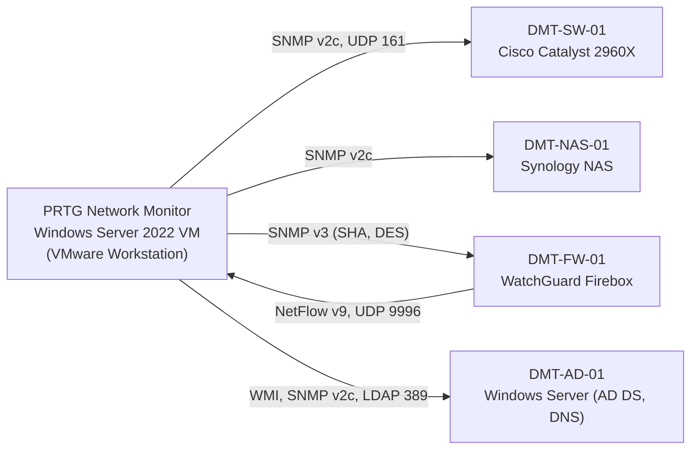

# PRTG Network Monitoring Home Lab: SNMP v2c/v3, NetFlow, WMI and Active Directory Monitoring

**Author:** Clinton Kehinde
**Platform:** PRTG Network Monitor (Paessler) on Windows Server 2022, running in VMware Workstation
**Status:** Completed

> *Monitoring is not just about collecting data. It is about turning data into insight, driving action, and making sure the monitoring platform itself is resilient.*

---

## Project Overview

Imagine it is 2:00 a.m. A critical server has silently gone offline, and the first sign of trouble is an angry customer who cannot reach a service. By then the outage has already hurt the business, and the IT team is reacting instead of preventing the problem. A good monitoring system is built to avoid exactly that.

I built a monitoring environment in my home lab using **PRTG Network Monitor**. PRTG is one of the most widely used infrastructure monitoring platforms, and its free edition (up to 100 sensors) is enough to practise the same techniques used in production networks.

I installed and secured PRTG, then used it to monitor a Cisco switch, a Synology NAS, a WatchGuard firewall and a Windows Server. Along the way I worked with **SNMP v2c, SNMP v3, WMI, LDAP and NetFlow**, and I tested that the alerts really fire.

---

## Objectives

- Install PRTG on a Windows Server 2022 VM and verify that its services run correctly.
- Secure the platform before using it (change default credentials, enable HTTPS, review notifications).
- Organise monitored devices with a clean group structure that uses inheritance.
- Monitor a Cisco Catalyst switch with SNMP v2c and test that failure alerts work.
- Monitor a Synology NAS with manually chosen sensors.
- Monitor a WatchGuard firewall with authenticated and encrypted SNMP v3.
- Collect NetFlow v9 traffic data from the firewall into PRTG.
- Monitor a Windows Server with both WMI and SNMP, and monitor Active Directory with LDAP.
- Build maps, reports and a backup strategy for the monitoring platform itself.

---

## What I Built

- A PRTG Network Monitor instance on a Windows Server 2022 VM in VMware Workstation.
- A hardened PRTG installation: default credentials changed, HTTPS enabled, notification templates reviewed.
- Monitoring of a **Cisco Catalyst switch** with SNMP v2c, including a controlled outage test.
- Monitoring of a **Synology NAS** with SNMP and manually configured sensors (disk, RAID, memory, traffic, ping).
- Monitoring of a **WatchGuard firewall** with SNMP v3 (authenticated and encrypted).
- **NetFlow v9** analysis from the WatchGuard firewall into PRTG.
- Monitoring of a **Windows Server** with WMI and SNMP, plus **Active Directory** monitoring with LDAP.
- Device grouping, sensor priorities, notifications, a network map, and configuration backups.

---

## Technologies Used

| Technology | How I used it |
| ---------- | ------------- |
| PRTG Network Monitor (Paessler) | The monitoring platform |
| VMware Workstation | Runs the PRTG server VM |
| Windows Server 2022 | PRTG server and the monitored AD server |
| SNMP v2c and v3 | Monitoring the switch, NAS, firewall and Windows Server |
| WMI | Deep monitoring of the Windows operating system |
| NetFlow v9 | Traffic analysis from the firewall |
| LDAP | Active Directory health checks |
| Cisco IOS CLI | Enabling SNMP on the switch |
| Synology DSM | Enabling SNMP on the NAS |
| WatchGuard Firebox | SNMP v3 and NetFlow export |
| Veeam Backup & Replication | VM-level backup of the PRTG server (see section 10) |

---

## Lab Environment

| Component | Specification |
| --------- | ------------- |
| Hardware | Personal home lab computer |
| CPU | Intel Core i5 (4 cores) |
| RAM | 8 GB |
| Storage | 256 GB SSD |
| Host OS | Windows 11 |
| Virtualisation | VMware Workstation (free) |
| Monitoring tool | PRTG Network Monitor (Paessler) |
| PRTG licence | Free (up to 100 sensors) |

### Monitored devices

| Device name | Device | Protocol(s) used | Document |
| ----------- | ------ | ---------------- | -------- |
| `DMT-SW-01` | Cisco Catalyst 2960X switch | SNMP v2c | [4](docs/04-monitoring-a-cisco-switch-snmpv2.md) |
| `DMT-NAS-01` | Synology NAS | SNMP v2c | [5](docs/05-monitoring-a-synology-nas.md) |
| `DMT-FW-01` | WatchGuard Firebox firewall | SNMP v3, NetFlow v9 | [6](docs/06-monitoring-a-firewall-snmpv3.md), [7](docs/07-netflow-traffic-analysis.md) |
| `DMT-AD-01` | Windows Server (Active Directory, DNS) | WMI, SNMP v2c, LDAP | [8](docs/08-monitoring-windows-servers-wmi-and-snmp.md), [9](docs/09-monitoring-server-roles-and-services.md) |

> **📸 Screenshot Placeholder**
> Insert screenshot showing: The VMware Workstation library with the PRTG Windows Server 2022 virtual machine powered on.

---

## Architecture

PRTG has two main services: the **Core Server** (web interface, database, alerts, reports) and the **Probe** (the part that actually polls devices). Both run on the same VM in my lab.

---

## Understanding the 100-Sensor Limit

I first assumed the free edition allowed 100 *devices*. It actually allows 100 **sensors**. A sensor is one monitoring metric on one device. A server with CPU, memory, disk, traffic and uptime sensors already uses five sensors. A 48-port switch with every interface monitored could use over half the allowance by itself.

This changed how I planned the lab: I picked the most valuable sensors for each device instead of collecting everything. I even deleted unneeded Disk Free sensors on the firewall for this reason (see [document 6](docs/06-monitoring-a-firewall-snmpv3.md)).

> [!NOTE]
> The free edition covers most home labs and many small environments. Larger deployments need a commercial licence from Paessler.

---

## Prerequisites

1. A Windows 11 computer with at least an Intel Core i5, 8 GB of RAM and 256 GB of storage.
2. VMware Workstation installed and working.
3. A Windows Server 2022 (or 2025) VM with a static IP address.
4. Access to the Paessler website to download PRTG Network Monitor.
5. At least one SNMP-capable device to monitor (a Cisco switch, Synology NAS, WatchGuard firewall, Windows Server or similar).

---

## Documentation Index

| # | Document | What it covers |
| - | -------- | -------------- |
| 1 | [Downloading and Installing PRTG](docs/01-downloading-and-installing-prtg.md) | Download, Express install, service check, first login |
| 2 | [Initial Setup and Security Hardening](docs/02-initial-setup-and-security-hardening.md) | Password, HTTPS, notifications, updates, first backup |
| 3 | [Organising Devices with Groups](docs/03-organising-devices-with-groups.md) | Group strategies, my structure, inheritance |
| 4 | [Monitoring a Cisco Switch (SNMP v2c)](docs/04-monitoring-a-cisco-switch-snmpv2.md) | SNMP concepts, switch config, sensors, outage test |
| 5 | [Monitoring a Synology NAS](docs/05-monitoring-a-synology-nas.md) | Manual sensors for disks, RAID, memory and traffic |
| 6 | [Monitoring a Firewall (SNMP v3)](docs/06-monitoring-a-firewall-snmpv3.md) | Authenticated, encrypted SNMP; inheritance; priorities |
| 7 | [NetFlow Traffic Analysis](docs/07-netflow-traffic-analysis.md) | NetFlow v9 export and the PRTG NetFlow sensor |
| 8 | [Monitoring Windows Servers (WMI and SNMP)](docs/08-monitoring-windows-servers-wmi-and-snmp.md) | WMI sensors, SNMP service, thresholds |
| 9 | [Monitoring Server Roles and Services](docs/09-monitoring-server-roles-and-services.md) | LDAP, replication, service sensors |
| 10 | [Maps, Reports, Ticketing and Backup](docs/10-maps-reports-ticketing-and-backup.md) | Live map, reports, tickets, layered backups |

---

## Security Considerations (Summary)

- I changed the default `prtgadmin` credentials straight away and enabled **HTTPS** before adding any device.
- I used **read-only** SNMP access everywhere, so monitoring cannot change device configuration.
- I used **SNMP v3** (separate authentication and privacy passwords) for the firewall.
- I restricted SNMP on the Windows Server to the PRTG server's IP address only.
- NetFlow data is unencrypted, so exports stay on the trusted internal network.
- I backed up PRTG's own configuration and the whole VM, because the monitoring server is itself a critical service.

---

## Production Considerations

| Area | My lab | In production I would |
| ---- | ------ | --------------------- |
| Admin accounts | One shared admin account | Use named accounts per engineer (audit logs, MFA, easy offboarding) |
| HTTPS certificate | Self-signed | Use a trusted CA (DigiCert, GlobalSign, Let's Encrypt or internal AD CS) |
| Updates | Automatic | Use manual updates, tested in a lab or staging first |
| SNMP v2c community | Single string on trusted LAN | Use SNMP v3, plus an access list limiting SNMP to the PRTG server's IP |
| SNMP v3 encryption | DES (only option on my appliance) | Use AES-128 or AES-256 and SHA instead of MD5 |
| Windows credentials | Built-in Administrator | Use a least-privilege service account such as `svc_prtg` |
| Alerting | Email and browser notifications, 24/7 | Multiple channels for critical systems, maintenance windows to suppress noise |
| Ticketing | Built-in lightweight tickets | Integrate with ServiceNow, Jira Service Management, ConnectWise or HaloPSA |

---

## Lessons Learned

1. **Secure the monitoring platform first.** It holds credentials and network topology that an attacker would love.
2. **Verify, do not assume.** I unplugged the switch's uplink on purpose to prove PRTG detects the outage and sends both the failure and recovery emails.
3. **Collect the right data, not all the data.** Sensors are limited, and too many alerts cause alert fatigue.
4. **Plan the group structure before adding devices.** Inheritance turns one setting into many.
5. **History beats snapshots.** Graphs over days and weeks reveal slow drift (for example a disk warming from 34°C to 49°C) before hardware fails.
6. **SNMP and NetFlow complement each other.** SNMP shows how busy an interface is; NetFlow shows why.
7. **Monitor services, not just servers.** A domain controller can look healthy while Active Directory is down.
8. **Back up the monitoring server itself.** A configuration backup and a VM backup protect different things; neither replaces the other.

---

## Future Improvements

- Move the firewall's SNMP v3 encryption from DES to AES where the hardware supports it.
- Replace the shared administrator account with named accounts, and the self-signed certificate with a trusted one.
- Replace the built-in Windows Administrator used for WMI and LDAP with a least-privilege service account.
- Restrict SNMP on the switch with an access list limited to the PRTG server.
- Add a second domain controller so the AD replication sensor has real partners to watch.
- Build real PowerShell custom sensors for checks no built-in sensor covers.

---

## Conclusion

This lab taught me that monitoring is about visibility *and* protecting that visibility. I moved from "is it online?" to "is it healthy, is it secure, and will I be told before users notice?" Along the way I tested my own alerts, secured the platform, and protected it with backups.

